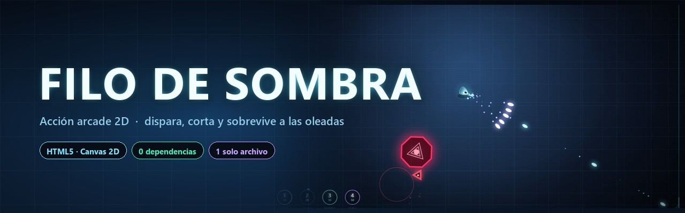
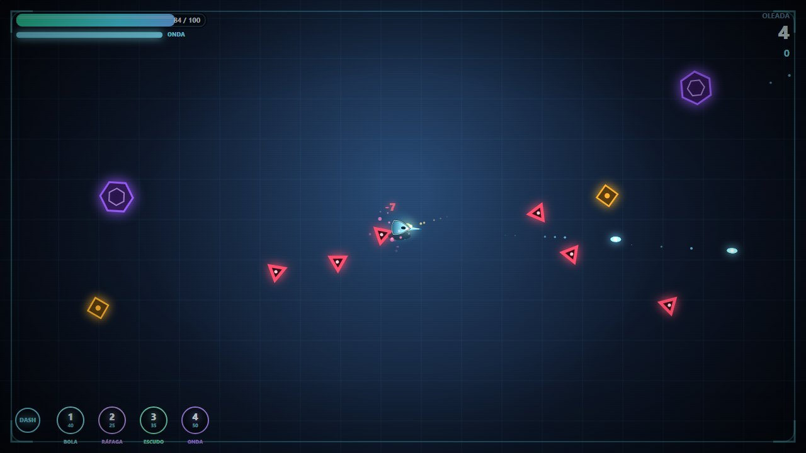
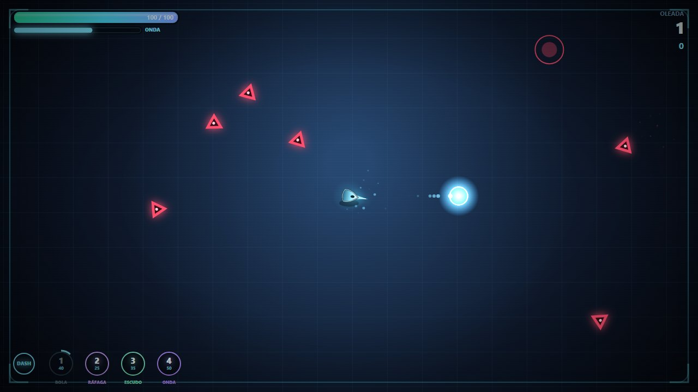
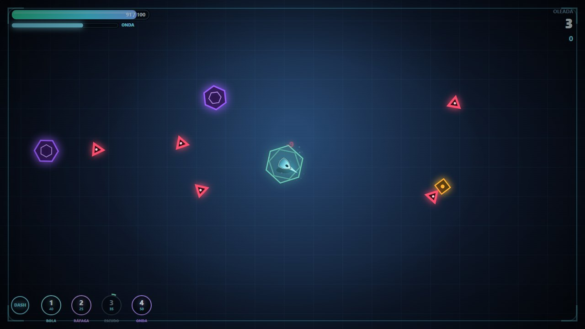
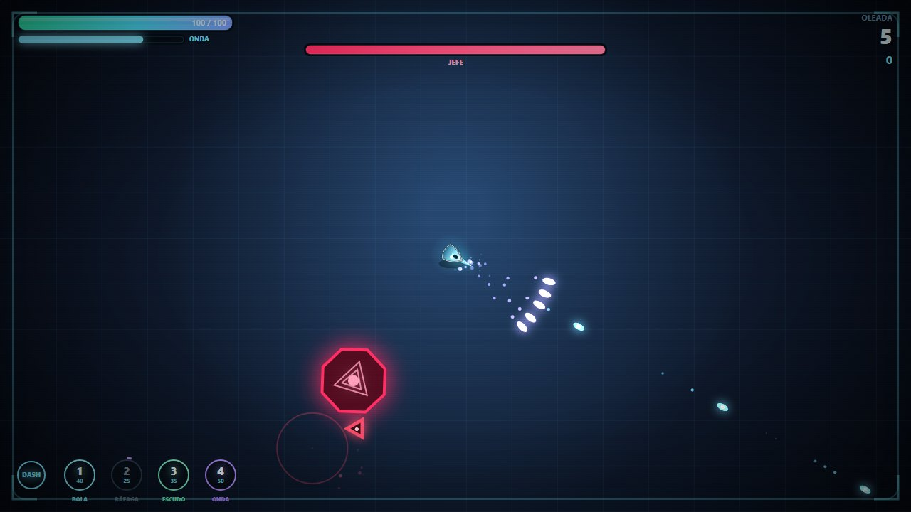
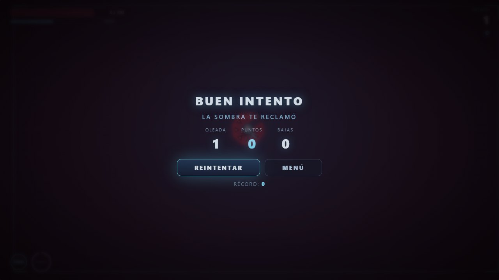

<div align="center">



<h3>Acción arcade 2D · dispara, corta y sobrevive a las oleadas</h3>

<p>
  <a href="https://fleremiasflemin20-maker.github.io/filo-de-sombra/"></a>
</p>

<p>
  
  
  
  
</p>

</div>

---

**Filo de Sombra** es un juego de acción 2D para el navegador. Te mueves por una arena,
disparas energía, cortas con el filo y sueltas técnicas mientras oleadas de enemigos intentan
rodearte. Cada cinco oleadas aparece un jefe.

Todo el juego —gráficos, sonido y lógica— cabe en **un único `index.html`**: no hay
dependencias, ni build, ni imágenes, ni fuentes externas. Se abre con doble clic y funciona
sin conexión.

## :video_game: Jugar

**En línea:** [fleremiasflemin20-maker.github.io/filo-de-sombra](https://fleremiasflemin20-maker.github.io/filo-de-sombra/)

**En local:** descarga el repositorio y abre `index.html` en Chrome, Edge o Firefox.

> No hace falta servidor. El juego usa `file://` sin problemas.

## :keyboard: Controles

| Acción | Teclado / ratón | Táctil |
| :-- | :-- | :-- |
| Mover | `W` `A` `S` `D` o flechas | stick izquierdo |
| Apuntar | ratón | stick derecho |
| Disparar | clic izquierdo (mantener) o `J` | stick derecho (automático) |
| Tajo | clic derecho, `F` o `L` | botón **Tajo** |
| Técnicas | `1` `2` `3` `4` (o `Q` = onda) | botones **1–4** |
| Esquivar | `Espacio` o `Shift` | botón **Esquiva** |
| Pausa | `P` o `Esc` | — |
| Silenciar | `M` | — |

## :zap: Técnicas

Cada técnica gasta energía y tiene recarga propia. La energía se recupera sola, y también
al acertar disparos y golpear, así que nunca te quedas sin recursos para siempre.

| # | Técnica | Coste | Recarga | Efecto |
| :-: | :-- | :-: | :-: | :-- |
| 1 | **Bola de energía** | 40 | 3,4 s | Orbe lento que explota en área (108 px) al impactar |
| 2 | **Ráfaga** | 25 | 2,6 s | Cinco proyectiles en abanico que atraviesan enemigos |
| 3 | **Escudo** | 35 | 7,5 s | 3 s de inmunidad y desvía las balas enemigas hacia ellos |
| 4 | **Onda** | 50 | 2,0 s | Onda expansiva que barre y empuja todo a tu alrededor |

El ataque normal tiene dos modos con recargas separadas: **disparo** (rápido, a distancia) y
**tajo** (cuerpo a cuerpo, golpea a varios y corta proyectiles).

## :space_invader: Enemigos

| Tipo | Color | Comportamiento |
| :-- | :-- | :-- |
| Perseguidor | rojo | va directo a por ti; rápido y frágil |
| Tirador | ámbar | mantiene la distancia y dispara proyectiles |
| Bruto | violeta | lento, mucha vida y golpe fuerte |
| **Jefe** | rojo intenso | anillo de balas, embestida telegrafiada e invocación de esbirros. Se enfurece al 45 % de vida |

## :camera: Capturas

<table>
  <tr>
    <td width="50%"></td>
    <td width="50%"></td>
  </tr>
  <tr>
    <td width="50%"></td>
    <td width="50%"></td>
  </tr>
</table>

<details>
<summary>Pantalla de derrota</summary>
<br>

</details>

## :sparkles: Lo que hace especial

- **Se siente bien golpear.** *Hitstop* de 45–70 ms, sacudida de cámara, destello al recibir,
  números de daño, partículas aditivas y cámara lenta al derribar al jefe.
- **Combate con decisiones.** El disparo es seguro pero flojo; el tajo pega fuerte y corta
  balas, pero te acerca al peligro. Las técnicas se pagan con energía que se gana atacando.
- **Progresión.** Mejoras entre oleadas (daño, vida, velocidad, recarga, onda, robo de vida,
  energía) y multiplicador de combo por bajas seguidas.
- **Sin assets.** Ni una imagen ni un audio descargado: las formas se dibujan en canvas y los
  efectos se sintetizan con WebAudio (osciladores y ruido filtrado).
- **Listo para móvil.** Dos sticks virtuales, botones de técnica y HUD que se adapta.
- **Récord guardado** en `localStorage` y pausa automática al perder el foco.

## :hammer_and_wrench: Cómo está hecho

```
.
├── index.html              # el juego completo (HTML + CSS + JS)
├── prueba-humo.cjs         # pruebas automáticas con DOM/canvas simulados
├── capturas/               # imágenes del README
└── .github/workflows/      # despliegue a GitHub Pages
```

- **Canvas 2D** con resolución lógica de 1280×720 escalada por `devicePixelRatio`.
- Bucle con `requestAnimationFrame`, `dt` limitado a 50 ms para que un frame perdido no rompa
  la física.
- Entidades en arrays simples y separación O(n²) entre enemigos (con decenas de unidades es
  más que suficiente).
- Audio 100 % procedural: cada efecto es una envolvente sobre un oscilador o un buffer de
  ruido.
- Sin frameworks, sin bundler, sin dependencias: 74 KB de archivo.

## :rocket: Ejecutar en local

```bash
git clone https://github.com/fleremiasflemin20-maker/filo-de-sombra.git
cd filo-de-sombra
# abre index.html, o si prefieres un servidor:
python -m http.server 8000
```

## :test_tube: Pruebas

`prueba-humo.cjs` ejecuta el juego en Node con un DOM y un canvas falsos, simula partidas y
comprueba el arranque, las oleadas, el combate, las cuatro técnicas, el jefe, la muerte y el
reinicio.

```bash
node prueba-humo.cjs
```

```
30/30 comprobaciones OK
```

## :control_knobs: Ajustar el balance

Casi todo vive en `index.html`:

| Qué | Dónde |
| :-- | :-- |
| Vida, daño, velocidad y recargas del jugador | `newPlayer()` |
| Vida, daño y velocidad de cada enemigo | `spawnEnemy()` |
| Tamaño de las oleadas | `startWave()` (`4 + n * 3`) |
| Coste, recarga y efecto de las técnicas | `SKILLS` y `cast*()` |
| Mejoras entre oleadas | `UPGRADES` |

También hay una API de depuración en la consola del navegador:

```js
__filo.state()        // oleada, vida, energía, enemigos…
__filo.advance(3)     // avanza 3 s de simulación
__filo.killAll()      // limpia la oleada
__filo.energy(100)    // llena la energía
__filo.startWave(5)   // salta al jefe
```

## :map: Ideas para la siguiente versión

- Técnicas con niveles (bola que rebota, ráfaga que persigue, escudo que explota al romperse).
- Un ataque definitivo con barra de furia.
- Enemigos que obliguen a usar una técnica concreta.
- Modo infinito con tabla de récords y modo contrarreloj.

## :page_facing_up: Licencia

[MIT](LICENSE) — úsalo, modifícalo y compártelo.
